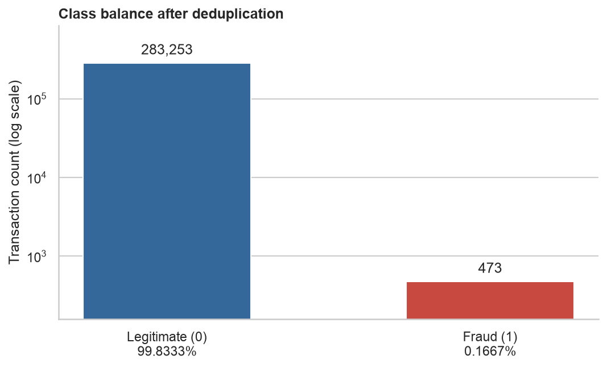

# Credit card fraud detection

Explore fraud in a highly imbalanced set of card transactions. The workflow covers environment setup, data validation, exploratory data analysis (EDA), chronological preprocessing, and a balanced logistic regression baseline.

## Step 0 · Set up the environment

The workflow was verified with Python 3.12 on macOS. With Git and Python installed, run the following:

```bash
git clone https://github.com/luis19vallejo02/fraud-detection.git
cd fraud-detection
python3.12 -m venv .venv
source .venv/bin/activate
python -m pip install -r requirements.txt
python -m pip check
python -c "import sklearn, xgboost, shap; print('ok')"
```

The final command should print `ok`. The [requirements file](requirements.txt) includes JupyterLab and the analysis dependencies.

## Step 1 · Download and inspect the data

Download [Credit Card Fraud Detection](https://www.kaggle.com/datasets/mlg-ulb/creditcardfraud) from Kaggle and extract `creditcard.csv` into `data/raw/`. Create the directory from the repository root with `mkdir -p data/raw`. Git ignores `data/raw/` and `data/processed/`.

Worldline and the Machine Learning Group at Université Libre de Bruxelles (ULB) collected the dataset. It spans roughly two days and contains 31 columns. `Class` is the label (0 for legitimate, 1 for fraud), `Time` is the number of seconds since the first transaction, and `Amount` is the transaction amount. `V1` through `V28` are anonymized PCA components whose original business variables are unknown.

| Data | Transactions | Fraud cases | Fraud rate |
| --- | ---: | ---: | ---: |
| Original CSV | 284,807 | 492 | 0.1727% |
| After deduplication | 283,726 | 473 | 0.1667% |

The initial inspection found zero missing values and 1,081 exact duplicate rows. The notebook keeps the first occurrence of each duplicate in memory and preserves the original CSV. Step 3 applies the same deduplication before the temporal split so identical rows cannot appear in multiple sets.

Kaggle lists the [Open Database License (ODbL)](https://opendatacommons.org/licenses/odbl/1-0/) for the database and the [Database Contents License (DbCL)](https://opendatacommons.org/licenses/dbcl/1-0/) for its contents. The repository code is under the [MIT license](LICENSE).

## Step 2 · Reproduce the exploratory analysis

From the repository root with `.venv` active, start JupyterLab with `python -m jupyterlab`. Open [notebooks/01_eda.ipynb](notebooks/01_eda.ipynb) and run all six code cells in order. The first two inspect and deduplicate the data. The next four generate the figures in `reports/figures/`. The final Markdown cell summarizes the findings.



| Figure | Finding |
| --- | --- |
| [Class balance](reports/figures/01_class_balance.png) | Predicting every transaction as legitimate on the original data yields 99.8273% accuracy and detects zero frauds. This imbalance motivates PR-AUC as the primary evaluation metric. |
| [Transaction amount by class](reports/figures/02_amount_by_class.png) | The fraud median was 9.82 versus 22.00 for legitimate transactions. Fraud had a higher mean (123.87 versus 88.41). The chart uses `log(1 + Amount)` to show the skewed distributions. |
| [Fraud rate by relative hour](reports/figures/03_fraud_by_hour.png) | Relative hour 2 had the highest observed rate, 1.45% (48 of 3,308 transactions). Hours are measured from the first transaction and grouped modulo 24. The roughly two-day window limits conclusions about weekly seasonality. |
| [Features ranked by absolute correlation](reports/figures/04_top_features.png) | `V17`, `V14`, `V12` and `V10` had the largest absolute Pearson correlations with the fraud label. The figure shows the six highest-ranked features. |

## Step 3 · Split chronologically and preprocess

With the environment from Step 0 and the CSV from Step 1, open [notebooks/02_baseline.ipynb](notebooks/02_baseline.ipynb) in JupyterLab and run the cells in order. [src/data.py](src/data.py) loads the same 283,726 deduplicated rows used in Step 2 and sorts them by `Time`. The split uses the earliest approximately 70% of rows for training, the next 15% for tuning and threshold selection, and the last 15% for final evaluation.

The nominal cuts at 70% and 85% fall inside groups of transactions with the same `Time`. Each cut moves to the start of its group, so every transaction at a boundary second goes into the later set. The notebook verifies strict time separation and at least one fraud case in each set.

| Set | Transactions | Fraud cases | Fraud rate | `Time` range (seconds) |
| --- | ---: | ---: | ---: | ---: |
| Train | 198,607 | 366 | 0.1843% | 0–132,905 |
| Validation | 42,558 | 55 | 0.1292% | 132,906–151,319 |
| Test | 42,561 | 52 | 0.1222% | 151,320–172,792 |

[src/features.py](src/features.py) removes `Time` from model inputs, keeps all 28 PCA components, and applies `log1p` followed by `RobustScaler` to `Amount`. This reuses the amount transformation explored in Step 2. The scaler learns the median and interquartile range from training alone and uses those same values for validation and test. `Class` is kept separately as the label. The notebook verifies these transformations before fitting the baseline.

With 52 fraud cases in test, detecting one additional case changes test recall by about 1.9 percentage points. The final recall estimate is therefore sensitive to a small number of cases.

## Step 4 · Fit and evaluate the baseline

Run the remaining cells of [notebooks/02_baseline.ipynb](notebooks/02_baseline.ipynb). The notebook fits logistic regression with `class_weight="balanced"`, `max_iter=2000`, and `random_state=42` on the preprocessed training set. It passes the fraud scores on validation and test to the reusable functions in [src/evaluate.py](src/evaluate.py).

| Set | PR-AUC (average precision) | ROC-AUC | Recall at ≥80% precision | Recall at ≥50% precision | PR-AUC with constant scores |
| --- | ---: | ---: | ---: | ---: | ---: |
| Validation | 0.812824 | 0.980591 | 74.55% | 85.45% | 0.001292 |
| Test | 0.689759 | 0.976271 | 69.23% | 75.00% | 0.001222 |

PR-AUC is the primary ranking metric. The reference with constant scores equals each set's fraud prevalence. On test, the majority-class classifier achieves 99.8778% accuracy and detects zero of 52 frauds.

Recall at fixed precision is computed over the score cutoffs available in each set. For later model comparisons, use the same temporal splits and compare validation PR-AUC. Choose an operating threshold on validation and report its performance on test with that threshold held fixed.
